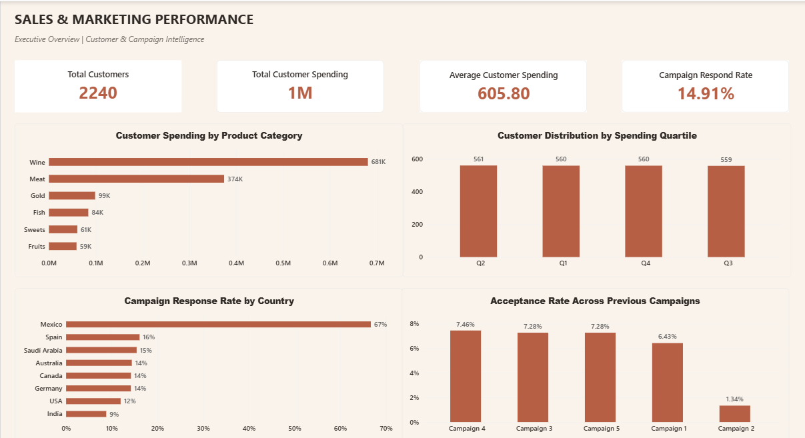
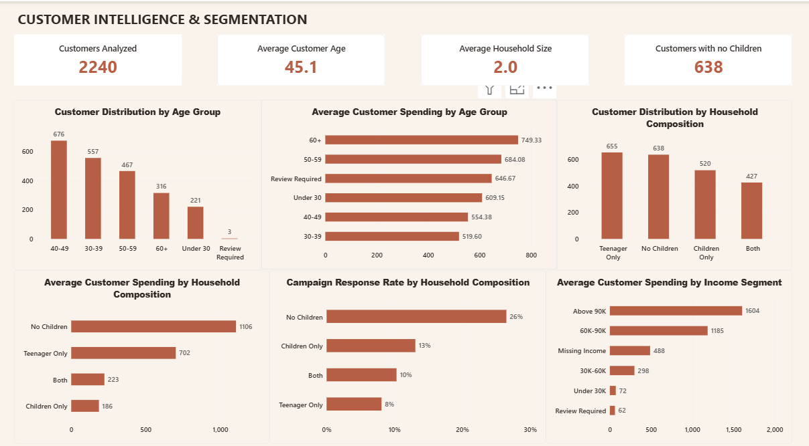
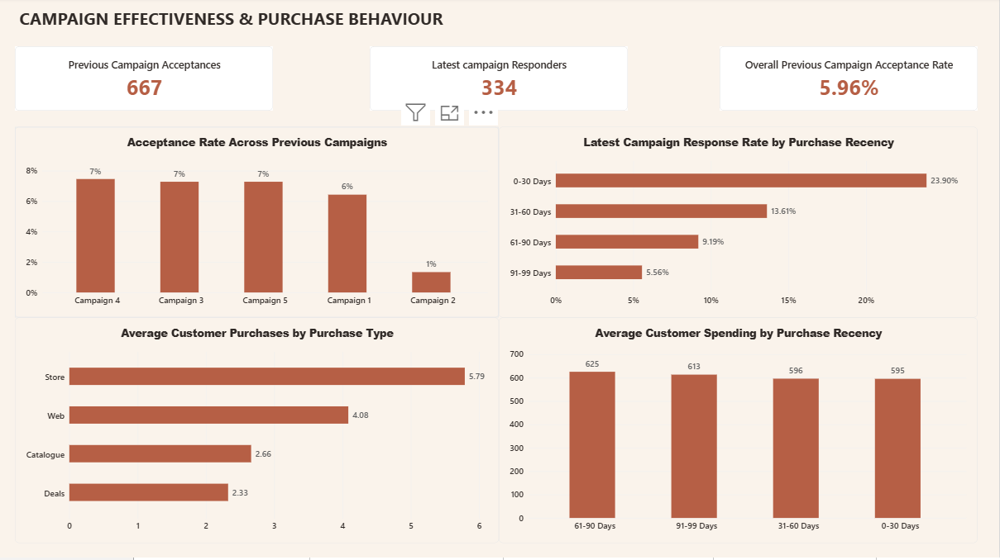
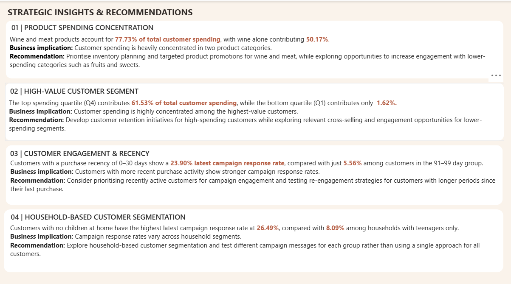
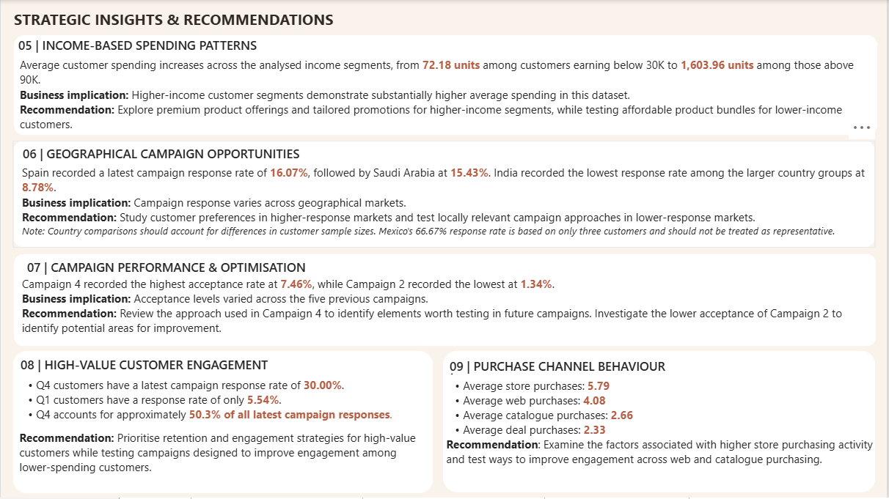

# Sales & Marketing Performance Intelligence

## Project Overview

This project analyses customer spending patterns, campaign performance and purchase behaviour using PostgreSQL and Power BI.

The objective is to transform raw customer and marketing data into actionable business insights that can support customer segmentation, campaign evaluation and strategic decision-making.

The project follows an end-to-end analytics workflow, covering data preparation, validation, relational data modelling, SQL-based business analysis, DAX calculations and interactive dashboard development.

## Dataset

**Dataset:** Maven Analytics – Marketing Campaign Results

**Source:** [Maven Analytics Data Playground](https://mavenanalytics.io/data-playground/marketing-campaign-results)

The dataset contains 2,240 customer records and 28 original columns covering:

- Customer demographics and household composition
- Income and customer enrollment information
- Spending across six product categories
- Store, web, catalogue and deal purchase activity
- Acceptance of five previous marketing campaigns
- Responses to the latest campaign
- Customer recency and complaint indicators

The data is customer-level and contains aggregated spending information rather than individual transaction records.

## Tools & Technologies

| Tool | Purpose |
|---|---|
| PostgreSQL | Data cleaning, validation, relational modelling and business analysis |
| SQL | Aggregations, joins, CTEs and window functions |
| Power BI Desktop | Interactive dashboard development and data visualisation |
| DAX | Measures, calculated columns, customer segmentation and KPI calculations |
| GitHub | Version control and project documentation |

## Data Preparation & Modelling

The project uses a structured PostgreSQL workflow to prepare and organise the customer marketing data.

Key activities include:

- Created a raw schema to store the imported dataset.
- Created a clean schema with appropriately typed and renamed columns.
- Handled missing income values and introduced review flags for suspicious income and birth-year records.
- Standardised selected marital-status categories.
- Validated duplicate customer IDs, data types, binary indicators and numeric values.
- Created a customer dimension table and a customer marketing fact table.
- Established primary key and foreign key constraints.
- Verified the relationship between the two tables through SQL joins.

The final data model contains 2,240 customer records in each table.

## SQL Business Analysis

SQL was used to investigate customer spending, campaign acceptance and purchase behaviour through 18 business analysis queries.

The analysis covered:

- Product category spending distribution
- Top customers by total spending using ranking functions
- Average customer spending across countries
- Latest campaign response rates by country
- Acceptance rates across five previous campaigns
- Purchase behaviour across store, web, catalogue and deals
- Relationship between web visits and purchase activity
- Income-based spending patterns
- Customer spending quartiles using NTILE
- Product spending across customer spending quartiles
- Campaign acceptance and response across spending segments
- Household composition and customer spending
- Household composition and campaign response
- Customer recency and spending patterns
- Customer recency and campaign response
- Age-based spending and response patterns

SQL techniques included aggregations, joins, CASE expressions, CTEs and window functions.

## Power BI Dashboard

An interactive five-page Power BI report was developed to present customer and marketing performance insights.
### Dashboard Preview

**01. Executive Overview**

**02. Customer Intelligence**

**03. Campaign Effectiveness**

**04. Strategic Insights**

**05. Strategic Recommendations**

### Dashboard Pages

**1. Executive Overview**
- Key performance indicators
- Customer spending by product category
- Customer distribution by spending quartile
- Campaign response rate by country

**2. Customer Intelligence**
- Customer age distribution
- Average spending by age group
- Household composition
- Spending by household type
- Campaign response by household composition
- Spending by income segment

**3. Campaign Effectiveness & Purchase Behaviour**
- Acceptance rates across five previous campaigns
- Average purchases by purchase type
- Latest campaign response by purchase recency
- Average customer spending by purchase recency

**4. Strategic Insights**

Highlights key findings from customer spending, campaign response, recency and household composition.

**5. Strategic Recommendations**

Presents data-driven recommendations for customer engagement, campaign evaluation, product focus and purchase behaviour.

## Key Business Insights

1. **Product Spending:** Wine and meat account for approximately 77.73% of total customer spending.

2. **Customer Value:** The highest spending quartile (Q4) contributes approximately 61.53% of total customer spending.

3. **Campaign Performance:** Campaign 4 recorded the highest previous campaign acceptance rate at 7.46%, while Campaign 2 recorded the lowest at 1.34%.

4. **Customer Engagement:** Customers with purchase recency of 0–30 days showed a 23.90% latest campaign response rate, compared with 5.56% among customers in the 91–99 day group.

5. **Household Composition:** Customers without children recorded a 26.49% latest campaign response rate, the highest among the household groups analysed.

6. **Income Segmentation:** Average customer spending increased across the analysed income segments, from 72.18 units for customers below 30K to 1,603.96 units for customers above 90K, excluding missing and flagged income records.

7. **Geographical Performance:** Spain recorded a 16.07% latest campaign response rate, followed by Saudi Arabia at 15.43%.

## Row-Level Security (RLS)

Row-Level Security was implemented in Power BI to demonstrate country-based data access restrictions.

Two static security roles were created and tested:

| Role | Country Filter | Customers Visible |
|---|---|---:|
| India_Regional_Manager | India | 148 |
| Spain_Regional_Manager | Spain | 1,095 |

Both roles were tested using Power BI Desktop's View As feature. KPI cards and dashboard visuals updated according to the selected role.

Dynamic user-based security has not been implemented.

## Project Limitations

- The dataset contains customer-level aggregated spending rather than transaction-level sales records.
- Actual marketing expenditure is unavailable; therefore, marketing ROI cannot be calculated.
- Purchase counts represent customer activity and do not establish revenue attribution to individual channels.
- Customer enrollment dates are not transaction dates, so monthly sales trends cannot be reconstructed.
- Campaign acceptance and response patterns indicate observed associations, not causal campaign impact.
- Income and spending values are presented in dataset units because no currency is specified.
- Country comparisons should account for differences in sample sizes.

